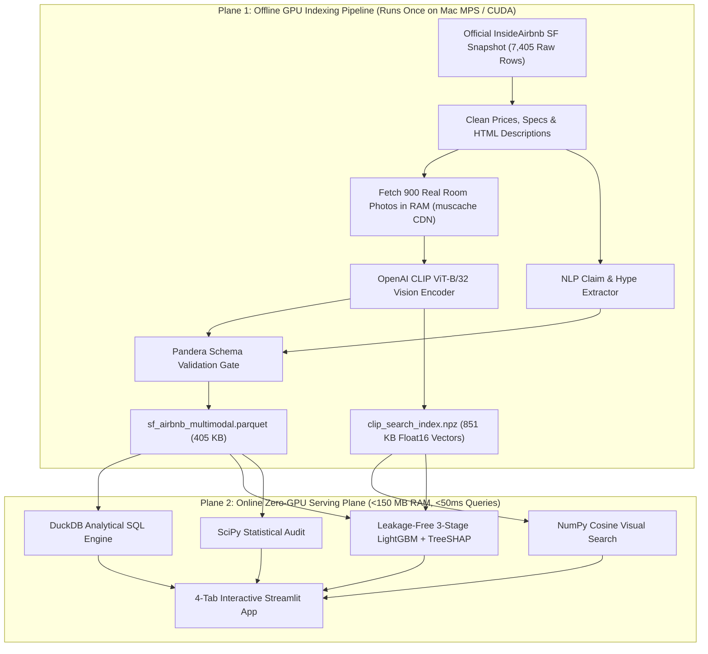

# 🔍 ListingTruth AI: Multimodal Rental "BS & Hidden Gem" Detector

[](https://listing-truth-ai.streamlit.app/)
[](https://www.python.org/)
[](https://huggingface.co/openai/clip-vit-base-patch32)
[](https://duckdb.org/)
[](https://lightgbm.readthedocs.io/)
[](https://insideairbnb.com/get-the-data/)
[](tests/)

🚀 **Live Interactive Dashboard:** [**https://listing-truth-ai.streamlit.app/**](https://listing-truth-ai.streamlit.app/) *(Test Natural-Language OpenAI `CLIP` Photo Search, Catfish vs. Hidden Gem Galleries, `TreeSHAP` Fair-Price Auditor, 3-Stage Ablation & live `DuckDB` SQL Playground directly in your browser)*

**ListingTruth AI** is an end-to-end **Multimodal Data Science & Computer Vision Valuation System** built on **100% real San Francisco `InsideAirbnb` listings and real room photographs** (`900` verified listings, **zero synthetic rows**).

Rental and Airbnb hosts routinely stuff descriptions with breathless marketing buzzwords (*"Sun-drenched! Spacious! Newly renovated luxury oasis!"*) even when the actual apartment is dark, cramped, or dated. By combining **NLP claim extraction**, **contrastive OpenAI `CLIP` (`ViT-B/32`) visual scoring**, **`DuckDB` analytical SQL**, **`SciPy` statistical testing**, and a **leakage-free `LightGBM` + `TreeSHAP` valuation engine**, this system:
1. Lets you **search real listing photos by visual reality** (*prompts hosts never write*, like *"dark cramped cluttered room"* or *"bright sunlit room with large windows"*).
2. Exposes **Catfish / Overhyped Listings** (sky-high text hype, poor photo reality) and **Hidden Gems** (high visual finish, modest copy, below-market rent).
3. Predicts each listing's **Multimodal Fair Nightly Value** and proves empirically via a **3-stage 5-fold cross-validation ablation** that **host text hype hurts price prediction (`R²` drops `0.431 -> 0.415`), whereas `CLIP` vision lifts `R²` to `0.480` (`+11.4%` relative gain over tabular specs)**.

---

## 🐐 Explain It So Simple Even a Goat Can Understand It

Imagine two people trying to rent you a bedroom for **`$220/night`**:

* **Host A** writes: *"STUNNING SUN-DRENCHED LUXURY DESIGNER PENTHOUSE OASIS!!"* — but if you actually look closely at the photo, it is a dim room with a sagging mattress pushed against the wall and zero windows.
* **Host B** is a busy homeowner who just writes: *"Quiet 1BR apartment near transit."* — yet the photo shows gleaming hardwood floors, huge bay windows pouring in sunlight, and a spotless modern kitchen.

**Why don't standard rental websites or star ratings catch this?**
1. **Keyword search is blind:** If you filter for *"bright modern apartment"*, keyword search shows you **Host A** (who lied in text) and hides **Host B** (who didn't brag).
2. **Star ratings are broken by "grade inflation":** On Airbnb, guests feel awkward leaving less than 5 stars unless the roof caves in. In our real San Francisco data, **almost every single listing sits squished around `4.85 / 5.0` stars**—even the wildly overhyped ones!
3. **Standard house-price ML models are blind too:** A normal spreadsheet model only sees `1 bedroom, 1 bathroom, Mission District = $210`. It has **no eyes** to tell a newly renovated loft apart from a 1970s basement!

**How our project fixes all three problems:**
1. **Step 1 — Read What the Host *Claims* (`NLP`):** Our text parser ([`text_claims.py`](src/listing_truth/text_claims.py)) reads the host's title and description and scores how hard they are bragging (`0–100` **Host Hype Score**) across 4 promises: *Brightness*, *Space*, *Luxury/Modernity*, and *Cleanliness*.
2. **Step 2 — Look at What the Photo *Actually Shows* (`OpenAI CLIP`):** OpenAI's **`CLIP` Vision-Language AI** ([`clip_scorer.py`](src/listing_truth/clip_scorer.py)) looks directly at the room photograph and scores it (`0–100`) by comparing the image against pairs of opposite visual descriptions (e.g., *"a bright sunlit room flooded with natural window light"* vs. *"a dark dim room with poor lighting"*).
3. **Step 3 — Compute the "Catfish Gap" & Fair Rent (`LightGBM` + `TreeSHAP`):**
   * **High Text Hype + Low Photo Score = 🚩 Catfish Risk!**
   * **High Photo Score + Modest Copy + Low Price = 💎 Hidden Gem!**
   * Finally, `LightGBM` combines spreadsheet specs + `CLIP` vision features to calculate what the room **should fairly cost per night**, and `TreeSHAP` explains every dollar of that fair price!

---

## 🏗️ Two-Plane System Architecture (Why It Runs Instantaneously Without a Cloud GPU)

A classic rookie mistake with multimodal AI apps is putting `PyTorch` + a `605 MB` neural network directly inside a free 1 GB cloud dashboard—causing instant Out-Of-Memory crashes and 30-second page loads.

Instead, **ListingTruth AI** uses a production **Two-Plane Architecture**:



### Clean Modular Repository Layout

```text
listing-truth-ai/
├── .github/workflows/ci.yml              # Automated GitHub Actions CI (unit + headless Streamlit UI tests)
├── configs/
│   └── vision_prompts.yaml               # 4 contrastive CLIP truth axes & 12 visual search prompts
├── data/
│   └── processed/
│       ├── sf_airbnb_multimodal.parquet  # 900 real validated SF listings + NLP & CLIP scores (405 KB)
│       └── clip_search_index.npz         # Compressed float16 512-dim CLIP image & query vectors (851 KB)
├── src/listing_truth/
│   ├── config.py                         # Canonical repo paths & YAML loader
│   ├── schemas.py                        # Pydantic + Pandera multimodal data quality contracts
│   ├── text_claims.py                    # HTML cleaner, hype scorer & zero-leakage Catfish Gap calculator
│   ├── clip_scorer.py                    # OpenAI CLIP (MPS/CUDA/CPU) batch encoder & contrastive scorer
│   ├── search_engine.py                  # Zero-GPU runtime cosine similarity photo search engine
│   ├── warehouse_sql.py                  # DuckDB analytical SQL over Parquet + read-only guardrails
│   ├── stats_audit.py                    # SciPy Mann-Whitney U & Spearman hypothesis tests
│   └── model.py                          # 3-stage out-of-fold LightGBM ablation + SVD + TreeSHAP
├── scripts/
│   ├── build_multimodal_index.py         # End-to-end InsideAirbnb + photo downloader + CLIP indexer
│   └── run_ablation_audit.py             # Reproduces artifacts/ablation_metrics.json in <10 seconds
├── app/
│   └── streamlit_app.py                  # 4-tab visual search, Fair-Price auditor, ablation & SQL UI
├── artifacts/
│   └── ablation_metrics.json             # Exact 5-fold CV R²/MAE ablation & SciPy p-values
└── tests/                                # 8 automated tests (schemas, anti-leakage, SQL, CLIP, AppTest)
```

---

## 📊 Real Empirical Results (`900` Real San Francisco Airbnb Listings)

*(100% real data from InsideAirbnb San Francisco; reproducible in 8 seconds via `python scripts/run_ablation_audit.py` and verified by `pytest`)*

### 1. Three-Stage Multimodal `LightGBM` Valuation Ablation (5-Fold Out-of-Fold CV)

> **Strict Anti-Leakage Engineering:**
> 1. **`catfish_gap_score` uses zero price data:** Computed strictly from NLP hype vs. `CLIP` photo scores; an automated unit test ([`test_catfish_gap_score_has_zero_price_leakage`](tests/test_schemas_and_text.py)) verifies mathematically that changing `price_usd` by `10x` changes `catfish_gap_score` by `0.0000`.
> 2. **Deal-ranking score excluded from features:** `hidden_gem_score` (which compares visual quality against price rank for consumer browsing) is strictly excluded from `LightGBM` inputs.
> 3. **In-fold `TruncatedSVD`:** During 5-fold CV, the `512-dim -> 8-dim` `CLIP` embedding projection is fit **strictly inside each training fold (`tr_idx`)** and applied to validation (`va_idx`).

| Ablation Stage | Modalities Used | 5-Fold Out-of-Fold `Log-Price R²` | Out-of-Fold `Log-RMSE` | Out-of-Fold `MAE ($ USD)` | Key Takeaway |
| :--- | :--- | :---: | :---: | :---: | :--- |
| **Stage 1: Tabular Only** | Neighborhood, Room Type, Guests, Bedrooms, Beds, Baths, Lat/Lon (`8` features) | `0.4309` | `0.6140` | `$189.26` | Solid structural baseline, but blind to interior condition. |
| **Stage 2: Tabular + Host Text** | Stage 1 + Hype Score, Word Count & 4 Claim Flags (`14` features) | `0.4149` *(🔻 `-0.0160`)* | `0.6226` | `$193.55` | **Host buzzwords actually hurt `R²`!** Budget hosts spam *"luxury"* & *"stunning"* just as much as real luxury lofts. |
| **Stage 3: Full Multimodal (`CLIP`)** | Stage 2 + 4 `CLIP` Visual Scores + Gap + 8 In-Fold `CLIP` SVD Vectors (`28` features) | **`0.4799`** *(🚀 **`+0.0490` / `+11.4%` vs Tabular**)* | **`0.5870`** | **`$182.64`** *(**`-$6.62/night` vs Tabular, `-$10.91` vs Text**)* | **Seeing the real photo wins:** `CLIP` visual embeddings unlock genuine interior quality signal that text lies about. |

**Top 6 Global `TreeSHAP` Fair-Price Drivers:**
1. `accommodates` (*Max Guests Accommodated*) — `mean |SHAP| = 0.255`
2. `clip_svd_4` (*`CLIP` Embedding Visual Component #4 — Interior Modernity & Staging*) — `0.149`
3. `latitude` (*North–South SF Micro-Location Gradient*) — `0.082`
4. `neighbourhood` (*SF Neighborhood Tier*) — `0.070`
5. `clip_svd_3` (*`CLIP` Embedding Visual Component #3 — Architectural Scale & Light*) — `0.055`
6. `bathrooms` (*Bathroom Count*) — `0.049`

### 2. `SciPy` Statistical Hypothesis Audits on Real SF Listings

* **Hypothesis 1 — Does Visual Finish Command Real Money? (`Mann-Whitney U`):**
  * Listings in the **top 25% of `CLIP` visual luxury finish** command a median nightly price of **`$353/night`** vs. **`$195/night`** in the bottom 25% — a **`+$158/night` (`+81%`) real market premium (`p = 1.71e-18`)**.
* **Hypothesis 2 — Do Host Descriptions Tell the Visual Truth? (`Spearman Rank Correlation`):**
  * Host `text_hype_score` correlates at only **`Spearman r = 0.109` (`p = 0.0011`)** with actual `CLIP` photo composite quality — proving statistically that superlative marketing copy is almost completely decoupled from how nice the room actually looks.
* **Hypothesis 3 — Do Public 5-Star Accuracy Ratings Warn Renters? (`Platform Grade-Inflation Audit`):**
  * Public `review_scores_accuracy` sits tightly compressed at **`4.83 / 5.0`** on visually verified rooms vs. **`4.88 / 5.0`** on high-Catfish-gap rooms (`two-sided Mann-Whitney p = 0.23`). Because of severe platform grade inflation, **public star ratings fail to separate overhyped rooms from honest ones**—proving why direct computer-vision auditing is essential.

---

## 🧰 Why We Used This Tech Stack — And Tech Stack Alternatives

| Layer | Chosen Tool | Why We Picked It Here | Alternatives Considered | Why We Rejected / When to Switch |
| :--- | :--- | :--- | :--- | :--- |
| **Vision-Language Backbone** | **OpenAI `CLIP` (`clip-vit-base-patch32`)** | Zero-shot contrastive scoring + natural-language photo search on consumer hardware (`Apple MPS` GPU) with **`$0` API cost**. | `GPT-4o / Gemini Vision API`, `ResNet-50`, `SigLIP / OpenCLIP ViT-L/14` | Paid Vision APIs cost money on every re-index and are slower for dense vector search; `ResNet-50` only classifies 1,000 ImageNet classes (can't understand *"dark cramped room"*). Upgrade to **`SigLIP-So400m`** for sharper fine-grained aesthetics when GPU budget allows. |
| **Vector Search Index** | **Compressed `NumPy` `float16` (`.npz`, `851 KB`)** | Exact cosine similarity over `900 x 512` vectors runs in **`<2 ms`** in pure `NumPy` with zero external database servers or `PyTorch` runtime overhead. | `Pinecone`, `Qdrant`, `FAISS`, `pgvector` | Running a managed `Pinecone` cluster or `FAISS` C++ index for `<50,000` vectors is pure infrastructure bloat. Switch to **`FAISS` (IVF-PQ) or `Qdrant`** once scaling past `250k–2M+` multi-city photos. |
| **Analytical Warehouse** | **`DuckDB` + `Parquet`** | Executes analytical `GROUP BY`, percentile filtering, and custom user SQL directly over `405 KB` `.parquet` in `<15 ms` at **`$0` cost**. | `Apache Spark`, `Snowflake`, `PostgreSQL`, `SQLite` | `Spark` on `<10 GB` is classic resume over-engineering; `DuckDB` reads `Parquet` column-by-column natively in-process. |
| **Multimodal Tabular + Vision Fusion** | **`LightGBM` + In-Fold `TruncatedSVD` (`8` dims)** | Feeding raw `512`-dim embeddings alongside `8` tabular cols into trees causes high-dimensional overfitting on `N=900`; compressing `CLIP` into `8` orthogonal `SVD` components + `4` semantic axes gives trees clean, dense signal. | End-to-end Fine-Tuned `ViT` + MLP, `Ridge / Lasso`, `CatBoost` | End-to-end neural multimodal fusion overfits badly under `<10k` tabular+image samples and loses `LightGBM`'s sharp spatial/categorical splits (`Lat/Lon × Room Type`). **`CatBoost`** is an excellent drop-in alternative. |
| **Explainability** | **`TreeSHAP`** | Exact, additive dollar/log-price attributions per listing in `<10 ms` so users see *why* a room is valued at `$195` instead of `$290`. | `LIME`, `Grad-CAM` | `LIME` perturbs features noisily; `Grad-CAM` highlights pixels on an image (`CLIP` patch attention) and makes a great *complementary* visual upgrade, while `TreeSHAP` explains the combined tabular + visual dollar price. |
| **Data Validation** | **`Pandera` + `Pydantic`** | Catches real-world `InsideAirbnb` anomalies (e.g., `$99,999` placeholder prices or `27`-bath hostel typos) automatically before modeling. | `Great Expectations`, Manual `assert`s | Lightweight, zero-daemon, native `DataFrame` contracts tested directly in `pytest`. |

---

## 🔄 Project Alternatives (Same Architecture, Different Domains)

Want to adapt this exact **Two-Plane Multimodal (`Text Claim vs. CLIP Photo Reality -> Fair Price`)** architecture to another industry? Here are 4 high-impact vertical swaps:

1. **🚗 Used-Car "Seller Hype vs. Cosmetic Condition" Auditor (`Cars24` / `Spinny` / `Craigslist`):**
   * **Text Claim:** *"Mint condition, scratchless showroom doctor-driven car!"*
   * **`CLIP` Visual Axes:** Exterior dent/paint-fade detection, interior seat wear, dashboard cleanliness, tire tread clarity -> **Used-Car Fair Valuation + Overpricing Alert**.
2. **🏢 Indian Long-Term Flat-Hunting "Broker BS Detector" (`NoBroker` / `MagicBricks` / `99acres`):**
   * **Text Claim:** *"Posh luxury semi-furnished 2BHK in Indiranagar with abundant ventilation!"*
   * **`CLIP` Visual Axes:** Natural ventilation/window area, kitchen modular finish vs. bare cement shelves, damp wall patches -> **Fair Monthly Rent (`₹/month`) + Hidden Gem Finder**.
3. **📦 E-Commerce "Studio Catalog Photo vs. Customer Review Photo" Gap (`Amazon` / `Myntra`):**
   * **Comparison:** Measure the `CLIP` cosine distance + quality drop between the **seller's studio hero image** and **verified buyer review photos** to flag high-return-risk "expectation trap" products before purchase.
4. **🍔 Food-Delivery "Menu Glamour Shot vs. Delivered Box" Portion Auditor (`Swiggy` / `Zomato` / `Yelp`):**
   * **Comparison:** Score restaurant menu promo photos against real diner-uploaded photos on portion fullness, freshness, and presentation to rank honest local kitchens.

---

## 🧬 Engineered Features & Feature Alternatives (Interview Roadmap)

### Current Leak-Free Features (`28` Features Across 3 Modalities)
* **Tabular Structural & Spatial (`8`):** `neighbourhood`, `room_type`, `accommodates`, `bedrooms`, `beds`, `bathrooms`, `latitude`, `longitude`.
* **NLP Host Marketing Claims (`6`):** `word_count`, `claims_bright_light`, `claims_spacious`, `claims_luxury_modern`, `claims_spotless_clean`, `text_hype_score` (`0–100`).
* **Contrastive `CLIP` Vision & Truth Gap (`6`):** `vis_brightness`, `vis_spaciousness`, `vis_luxury_finish`, `vis_cleanliness`, `vis_composite_quality`, `catfish_gap_score` *(strictly invariant to price)*.
* **Dense `CLIP` Latent Semantics (`8`):** `clip_svd_1` … `clip_svd_8` *(fit strictly inside each CV fold)*.

### 8 High-Impact Feature Upgrades (If Extending to Production v2)

| Proposed Feature Alternative | How to Compute It | Why It Improves Accuracy / Catfish Detection |
| :--- | :--- | :--- |
| **1. Multi-Photo Gallery & "Missing Bathroom" Penalty** | Score all `10–25` photos per listing with `CLIP` room-type classification (*bedroom, bathroom, kitchen, exterior*). | Hosts with ugly/shared bathrooms systematically **omit bathroom photos**; a `missing_bathroom_photo` flag is a massive real-world red flag. |
| **2. Wide-Angle Fisheye Distortion Detector** | Estimate straight-line curvature / vanishing-point FOV via `OpenCV` Hough lines on room edges. | Catches hosts using `0.5x` ultra-wide lenses to make a `90 sq ft` bedroom look like a ballroom. |
| **3. OpenStreetMap Street-Noise & Walkability Join** | Spatial join `(latitude, longitude)` within `150m` against `OSM` bars, nightclubs, highways, parks & BART/Muni stops. | Explains micro-location price differences inside the same neighborhood (*quiet tree-lined block vs. loud highway overpass*). |
| **4. Aspect-Based Sentiment on Guest Text Reviews** | Run lightweight aspect sentiment over `reviews.csv.gz` for phrases like *"smaller than pictures"*, *"street noise"*, *"dark"*. | Bypasses Airbnb's `4.85/5.0` star-rating inflation by extracting candid complaints buried inside 5-star text reviews! |
| **5. Conformal Fair-Price Intervals (`MAPIE`)** | Wrap `LightGBM` in Split Conformal Regression (`alpha = 0.10`). | Outputs a calibrated **90% Fair-Price Range** (e.g., *"`$165–$215/night`"* instead of a single point estimate). |
| **6. Dense Text Embeddings (`BAAI/bge-small-en`)** | Replace regex claim flags with `384`-dim semantic text embeddings (`SVD` compressed). | Captures subtle listing perks (*heated floors, dedicated standing desk, EV charger, private garden*) missed by keyword lexicons. |
| **7. Aesthetic Predictor Head (`LAION Aesthetics MLP`)** | Apply LAION's linear aesthetic weights directly on `CLIP` embeddings. | Separates professional architectural photography from blurry smartphone snapshots (`photo staging bias` vs. `room quality`). |
| **8. Calendar Booking Velocity (`calendar.csv.gz`)** | Compute 30-day forward occupancy rate from InsideAirbnb availability calendars. | Distinguishes an overpriced listing sitting **0% booked** from a true luxury home booked **90% solid** at `$450/night`. |

---

## 🚀 Quickstart (Run Locally in 30 Seconds)

### 1. Clone & Install Lightweight Serving Dependencies (No GPU Needed!)
```bash
git clone https://github.com/velagapudirushi/listing-truth-ai.git
cd listing-truth-ai
pip install -r requirements.txt
```

### 2. Launch the 4-Tab Interactive Streamlit App
```bash
streamlit run app/streamlit_app.py
```

### 3. Run the Automated Test Suite (`8` Tests + Headless Streamlit UI Check)
```bash
pytest -v
```

### 4. *(Optional)* Re-Download Fresh `InsideAirbnb` Photos & Re-Score With `OpenAI CLIP` on GPU
If you want to rebuild the dataset from scratch or point [`configs/vision_prompts.yaml`](configs/vision_prompts.yaml) at another city (e.g., `united-states/ny/new-york-city` or `united-kingdom/england/london`):
```bash
pip install ".[vision]"
python scripts/build_multimodal_index.py
python scripts/run_ablation_audit.py
```
